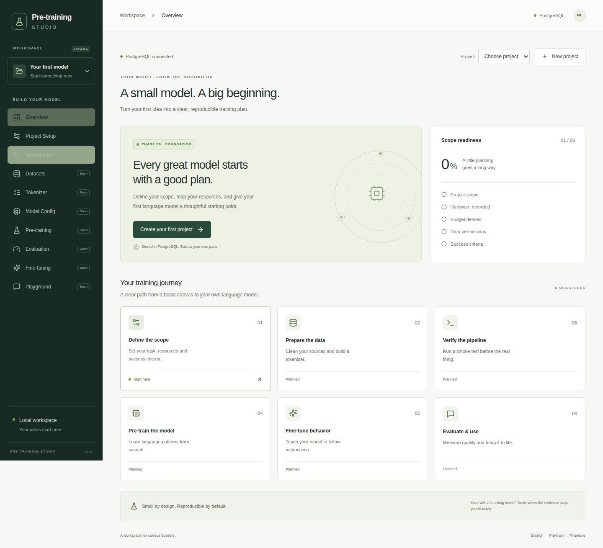
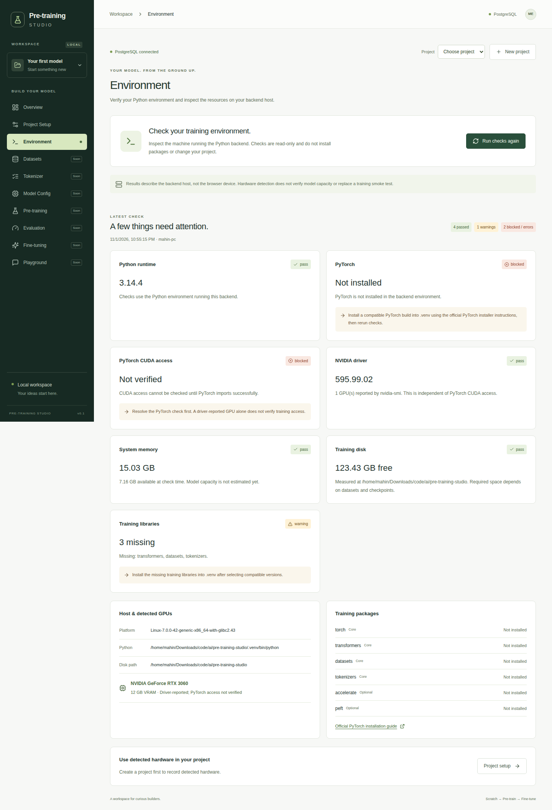
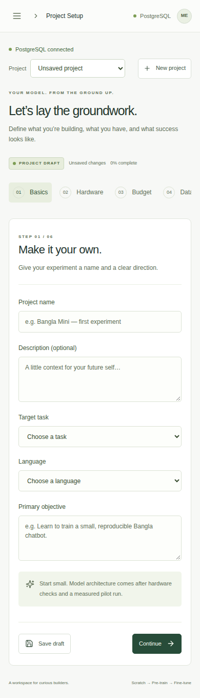
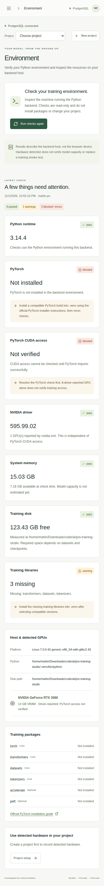

# Pre-training Studio

A local workspace for building a small language model, from requirements to pre-training and fine-tuning.

React + TypeScript frontend, Python/FastAPI backend, and **PostgreSQL project storage**. Overview, Project Setup, and Environment are implemented. Datasets and training execution are later milestones.

## UI screenshots

### Overview

Project dashboard with scope readiness and the training roadmap.



### Environment

Real backend-host checks for Python, PyTorch/CUDA, NVIDIA drivers, RAM and disk. Results reflect the machine and packages available when the screenshot was captured.

<details>
<summary>View the desktop Environment screen</summary>



</details>

### Mobile layouts

| Project Setup | Environment |
| --- | --- |
|  |  |

## Run everything

Prerequisites: Python 3.11+ with `venv`/`ensurepip`, Node.js 22.12+ (22.x) or 24.x, npm, and Docker with Compose. Verified on Linux with Python 3.14 and Node 24.

From the repository root:

```bash
python3 scripts/dev.py
```

The launcher creates an ignored `.env` with a random database password, creates `.venv`, installs pinned Python and npm dependencies when needed, starts PostgreSQL, applies versioned SQL migrations, and starts Python and React. First startup downloads the PostgreSQL image and dependencies.

- Studio: http://127.0.0.1:5173
- API docs: http://127.0.0.1:8000/docs
- PostgreSQL: `127.0.0.1:55432`

Ctrl+C stops React and Python. PostgreSQL stays in Docker, with data in the named `postgres_data` volume. `docker compose stop db` stops the database without deleting it. Start again with the same command. Configure ports in `.env` if they are occupied.

The app is a local personal workspace: application servers and database bind to loopback. It has no user accounts or public hosting configuration.

## Existing PostgreSQL

Copy `.env.example` to `.env`, then set `DATABASE_URL` to your PostgreSQL connection URL. Percent-encode special characters in usernames/passwords. The launcher skips Docker startup when `DATABASE_URL` is present. The database must already exist; the app creates its own tables and migration history. Runtime credentials need table/index creation and read/write permissions.

Keep `.env` private. The browser never receives database credentials. PostgreSQL is the only supported project database; there is no SQLite or browser-storage fallback.

## Start processes separately

```bash
python3 -m venv .venv
.venv/bin/python -m pip install -r backend/requirements.txt
# Configure .env first, or use scripts/dev.py for automatic configuration.
docker compose up -d --wait db
.venv/bin/python -m uvicorn app.main:app --app-dir backend --host 127.0.0.1 --port 8000
```

In another terminal:

```bash
cd frontend
npm ci
npm run dev
```

Vite proxies `/api` requests to Python. `.env` ports are honored by the one-command launcher; set `API_PORT` for the frontend proxy when running separately.

For one Python server serving both the API and UI:

```bash
npm run build --prefix frontend
.venv/bin/python -m uvicorn app.main:app --app-dir backend --host 127.0.0.1 --port 8000
```

Open http://127.0.0.1:8000 after restarting the backend with a build present. Hash-based UI routes work through the same server.

## Project behavior

- Create, select, edit, and restore multiple projects from PostgreSQL. The latest updated project opens initially.
- Valid partial drafts can be saved. Server-side schemas validate numbers, enums and scope readiness independently of the browser.
- The server sets timestamps and revisions. Concurrent edits return a conflict instead of silently overwriting another tab's saved changes. Reload before retrying a conflict; unsaved edits remain open until discarded.
- Saves wait for server confirmation. Connection/database errors are visible and keep edits in the form. Unsaved edits are in memory until saved; they are not an offline backup.
- Legacy Step 1 browser drafts can be explicitly imported as a new project and saved to PostgreSQL. The original browser draft stays untouched. Open the same browser origin used in Step 1 to see that draft.
- Source fields store metadata only. No dataset contents, secrets, GPU installation or training run is created by this milestone.

## Environment checks

Open **Environment → Run environment checks**. The backend checks:

- Its Python interpreter and installed training package versions.
- PyTorch import and CUDA/device access, in a subprocess with a timeout.
- NVIDIA driver and reported GPU memory, independently of PyTorch access.
- Total/available RAM and free disk at `STUDIO_DATA_DIR` (repository root by default).

Results describe the **backend host**, not the browser device or a remote cloud training machine. Missing packages, CPU-only PyTorch, timeouts, and unavailable disk paths are reported with next actions. PyTorch and training libraries are intentionally not installed by the app setup: choose a hardware-compatible build separately using the official PyTorch installer. Install training packages into the same `.venv` that runs the backend.

You can explicitly copy PyTorch-visible GPU details, RAM and free disk to a local project draft, then review/save it. This is disabled for cloud projects and when GPU visibility is unverified. Heterogeneous GPU memory uses the smallest detected VRAM value. Checks do not run a forward/backward pass, estimate model capacity, or guarantee training readiness.

## Verify

```bash
npm test --prefix frontend
npm run build --prefix frontend
.venv/bin/python -m pytest
```

Backend integration tests use **real PostgreSQL**, creating and dropping a uniquely named test database. The configured PostgreSQL role must have `CREATEDB` permission for these tests (the local Docker role does). Alternatively set `TEST_DATABASE_URL` to a dedicated database whose name contains `test`; tests retain their uniquely identified records there and never clear the application database. Environment-probe unit tests simulate missing packages, timeouts and GPU outcomes.

SQL migrations are in `backend/migrations/`. Each migration is recorded transactionally, with an advisory lock preventing concurrent migration runs. Future schema changes should add a new numbered SQL migration.

## API

- `GET /api/health` — checks PostgreSQL connectivity.
- `GET /api/projects` — saved projects, latest first.
- `POST /api/projects` — create a project with revision 0.
- `GET /api/projects/{id}` — restore one project.
- `PATCH /api/projects/{id}` — submit the full edited project with its current revision; returns the next revision.
- `GET /api/environment` — run read-only host checks (may take up to about 30 seconds).

## Plans and verification

- [Full training roadmap](MODEL_TRAINING_PLAN.md)
- [Remaining work and lightweight-first roadmap](REMAINING_WORK_PLAN.md)
- [Step 1 UI plan](STEP_1_UI_PLAN.md)
- [Step 2 implementation notes](STEP_2_BACKEND_PLAN.md)
- [Step 2 verification](artifacts/STEP_2_VERIFICATION.md)
- [Verification artifacts](artifacts/)
