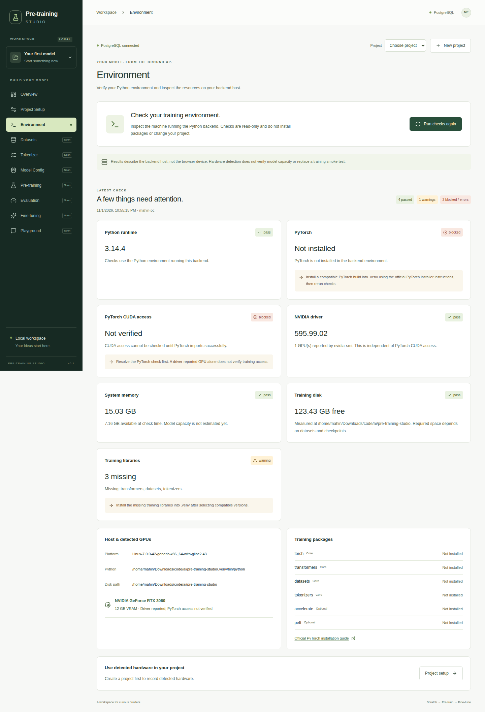
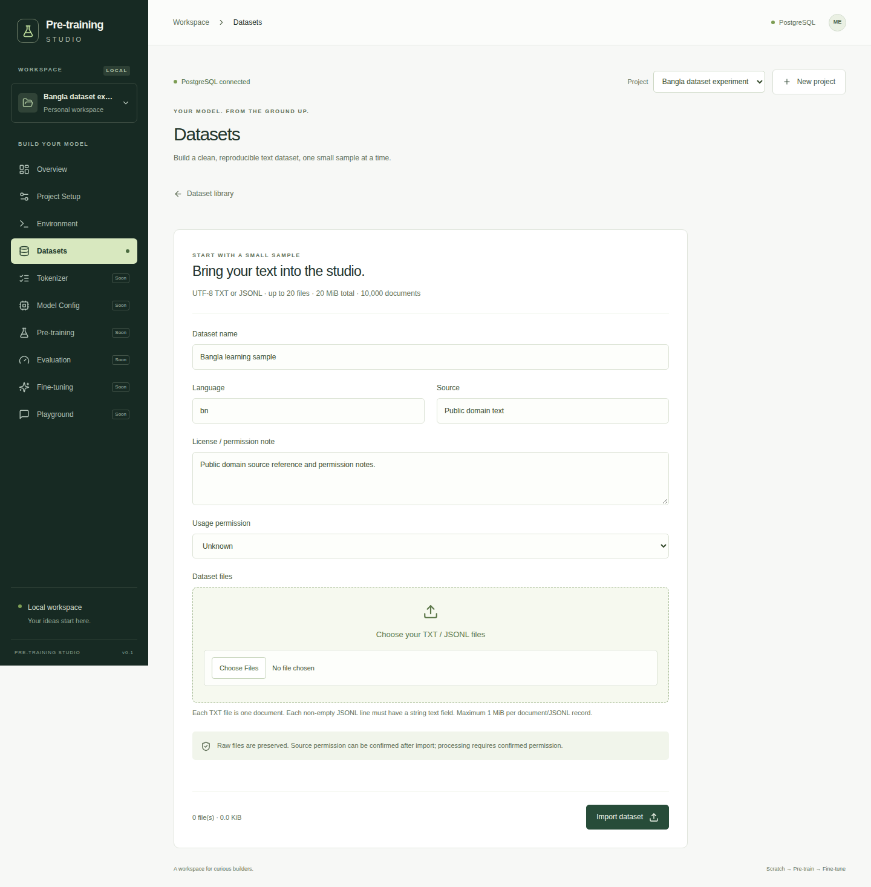
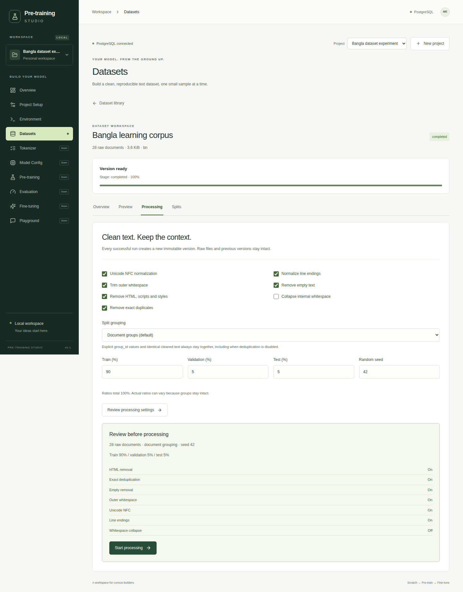
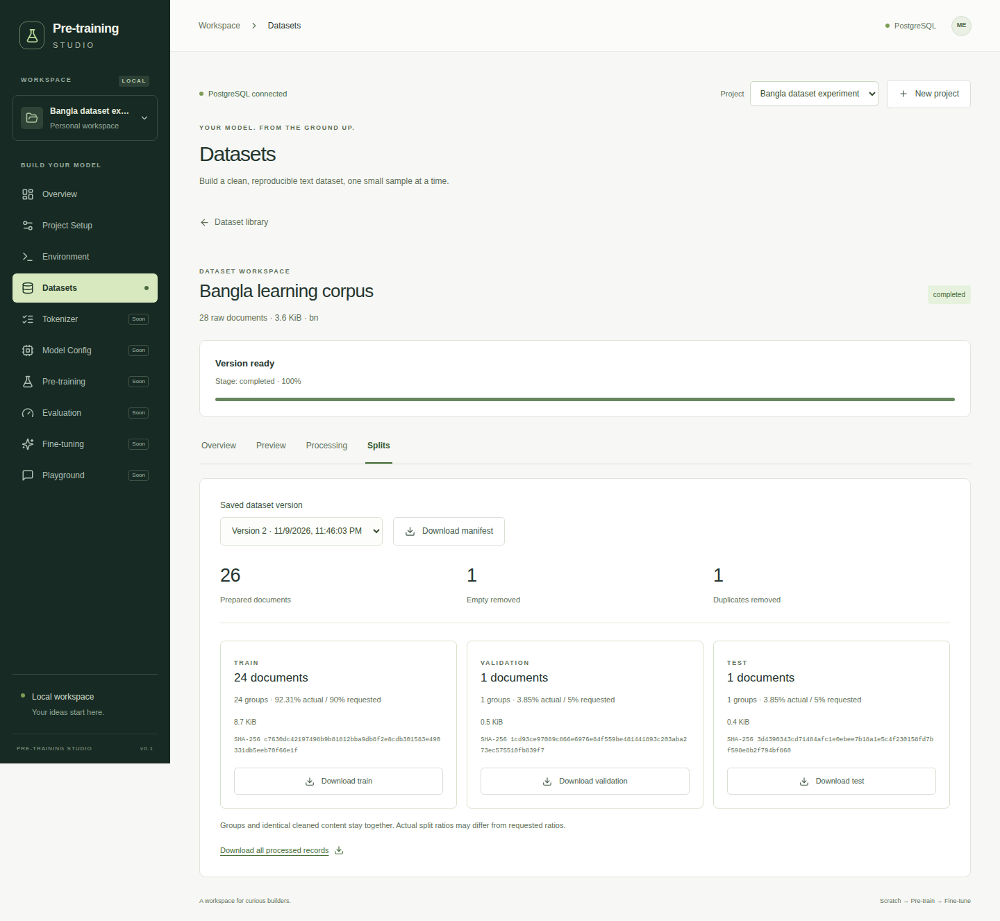
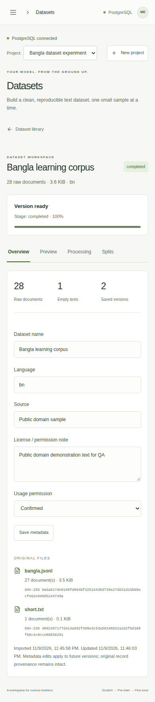

# Pre-training Studio

A local workspace for building a small language model, from requirements to pre-training and fine-tuning.

React + TypeScript frontend, Python/FastAPI backend, and **PostgreSQL project storage**. Overview, Project Setup, Environment, and the small-data Datasets pipeline are implemented. Tokenizer/model training remain later milestones.

## UI screenshots

### Overview

Project dashboard with scope readiness and the training roadmap.


### Environment

Real backend-host checks for Python, PyTorch/CUDA, NVIDIA drivers, RAM and disk. Results reflect the machine and packages available when the screenshot was captured.

<details>
<summary>View the desktop Environment screen</summary>



</details>

### Mobile layouts

| Project Setup                                                                                                         | Environment                                                                                                   |
| --------------------------------------------------------------------------------------------------------------------- | ------------------------------------------------------------------------------------------------------------- |
|  |  |

### Datasets

Import and inspect raw text, review cleaning settings, then download versioned train/validation/test splits.


<details>
<summary>View dataset import, preview and processing screens</summary>








</details>

| Mobile dataset overview                                                                                                     | Mobile prepared splits                                                                                           |
| --------------------------------------------------------------------------------------------------------------------------- | ---------------------------------------------------------------------------------------------------------------- |
|  |  |

## Run everything

Prerequisites: Python 3.11+ with `venv`/`ensurepip`, Node.js 22.12+ (22.x) or 24.x, npm, and Docker with Compose. Verified on Linux with Python 3.14 and Node 24.

From the repository root:

```bash
python3 scripts/dev.py
```

The launcher creates an ignored `.env` with a random database password, creates `.venv`, installs pinned Python and npm dependencies when needed, starts PostgreSQL, applies versioned SQL migrations, and starts Python and React. First startup downloads the PostgreSQL image and dependencies.

- Studio: http://127.0.0.1:5173
- API docs: http://127.0.0.1:8000/docs
- PostgreSQL: `127.0.0.1:55432`

Ctrl+C stops React and Python. PostgreSQL stays in Docker, with data in the named `postgres_data` volume. `docker compose stop db` stops the database without deleting it. Start again with the same command. Configure ports in `.env` if they are occupied.

The app is a local personal workspace: application servers and database bind to loopback. It has no user accounts or public hosting configuration.

## Existing PostgreSQL

Copy `.env.example` to `.env`, then set `DATABASE_URL` to your PostgreSQL connection URL. Percent-encode special characters in usernames/passwords. The launcher skips Docker startup when `DATABASE_URL` is present. The database must already exist; the app creates its own tables and migration history. Runtime credentials need table/index creation and read/write permissions.

Keep `.env` private. The browser never receives database credentials. PostgreSQL is the only supported project database; there is no SQLite or browser-storage fallback.

## Start processes separately

```bash
python3 -m venv .venv
.venv/bin/python -m pip install -r backend/requirements.txt
# Configure .env first, or use scripts/dev.py for automatic configuration.
docker compose up -d --wait db
.venv/bin/python -m uvicorn app.main:app --app-dir backend --host 127.0.0.1 --port 8000
```

In another terminal:

```bash
cd frontend
npm ci
npm run dev
```

Vite proxies `/api` requests to Python. `.env` ports are honored by the one-command launcher; set `API_PORT` for the frontend proxy when running separately.

For one Python server serving both the API and UI:

```bash
npm run build --prefix frontend
.venv/bin/python -m uvicorn app.main:app --app-dir backend --host 127.0.0.1 --port 8000
```

Open http://127.0.0.1:8000 after restarting the backend with a build present. Hash-based UI routes work through the same server.

## Project behavior

- Create, select, edit, and restore multiple projects from PostgreSQL. The latest updated project opens initially.
- Valid partial drafts can be saved. Server-side schemas validate numbers, enums and scope readiness independently of the browser.
- The server sets timestamps and revisions. Concurrent edits return a conflict instead of silently overwriting another tab's saved changes. Reload before retrying a conflict; unsaved edits remain open until discarded.
- Saves wait for server confirmation. Connection/database errors are visible and keep edits in the form. Unsaved edits are in memory until saved; they are not an offline backup.
- Legacy Step 1 browser drafts can be explicitly imported as a new project and saved to PostgreSQL. The original browser draft stays untouched. Open the same browser origin used in Step 1 to see that draft.
- Project Setup source fields hold planning metadata. Datasets stores uploaded raw files and prepared versions on local disk, with PostgreSQL metadata. Training is not started by data processing.

## Environment checks

Open **Environment → Run environment checks**. The backend checks:

- Its Python interpreter and installed training package versions.
- PyTorch import and CUDA/device access, in a subprocess with a timeout.
- NVIDIA driver and reported GPU memory, independently of PyTorch access.
- Total/available RAM and free disk at `STUDIO_DATA_DIR` (repository root by default).

Results describe the **backend host**, not the browser device or a remote cloud training machine. Missing packages, CPU-only PyTorch, timeouts, and unavailable disk paths are reported with next actions. PyTorch and training libraries are intentionally not installed by the app setup: choose a hardware-compatible build separately using the official PyTorch installer. Install training packages into the same `.venv` that runs the backend.

You can explicitly copy PyTorch-visible GPU details, RAM and free disk to a local project draft, then review/save it. This is disabled for cloud projects and when GPU visibility is unverified. Heterogeneous GPU memory uses the smallest detected VRAM value. Checks do not run a forward/backward pass, estimate model capacity, or guarantee training readiness.

## Datasets: prepare a small sample

1. Save a project, open **Datasets**, and choose **Import dataset**.
2. Enter its name, language, source, license/permission note and permission status. Upload UTF-8 TXT/JSONL or text-based PDF files.
3. Inspect **Overview** and **Preview**. Raw files remain intact; previews show up to 20 records per page and truncate long text at 4,000 characters. Downloads retain full text.
4. Confirm source usage permission in Overview and save metadata. Confirmation is required before processing. Active jobs lock metadata edits; past versions retain their original metadata snapshot.
5. In **Processing**, choose cleanup, deduplication, grouping, split percentages and seed. Review the summary, then start processing. Status updates every two seconds; cancellation and retry are available.
6. In **Splits**, select a successful version and download JSONL splits, all processed records or the manifest. Reloading restores dataset/version records from PostgreSQL.
7. To remove an accidental duplicate, open that dataset and choose **Delete upload**, then confirm. This permanently removes only that imported dataset, its processing history and saved versions; your original file and separately imported copies remain. Cancel or finish active processing first.

Limits per import: **20 files, 20 MiB total, 10,000 documents**. A TXT file is one document; each non-empty JSONL line is one record. Each TXT document/JSONL line is limited to 1 MiB. Unsupported formats/encoding and invalid records are rejected with file/line errors. Use a small sample first; this version does not download remote datasets.

**PDF import:** Selectable text is extracted page by page (maximum 1,000 pages, 1 MiB extracted text per page and 20 MiB extracted text per PDF). Original PDFs are preserved. Each text page becomes a record with its original page number; all pages of the same PDF are grouped together to prevent train/validation/test leakage, including repeated uploads of identical PDF bytes. A single PDF defaults to 100/0/0 splits in the UI. Textless pages are skipped and listed in Overview. Fully scanned/image-only, password-protected and corrupt PDFs are rejected with actionable messages. OCR is not included; run OCR externally before importing scanned files. Review Preview for extraction quality, especially complex layouts and tables.

TXT files may contain multi-line text and an optional UTF-8 BOM. JSONL requires a string `text`; optional `source`, `language` and `group_id` must also be strings:

```jsonl
{"text":"বাংলা শেখার প্রথম উদাহরণ।","source":"Books","language":"bn","group_id":"book-1"}
{"text":"একই বইয়ের আরেকটি অংশ।","source":"Books","language":"bn","group_id":"book-1"}
{"text":"দ্বিতীয় বইয়ের উদাহরণ।","source":"Books","language":"bn","group_id":"book-2"}
{"text":"তৃতীয় বইয়ের উদাহরণ।","source":"Books","language":"bn","group_id":"book-3"}
```

Missing record source/language inherits the import form values. Empty text records are counted at import and removed by default during cleaning. Unicode NFC, line-ending normalization, outer trimming, empty removal and exact deduplication default on. HTML/script/style removal and internal whitespace collapse default off. Bangla joiners and meaningful characters are preserved.

The default split is **90/5/5**, seed **42**. Explicit `group_id` values and identical cleaned content stay in the same split, including when deduplication is off. Source grouping additionally keeps each source together. Deduplicated records keep the first document and merge provenance. Actual ratios may differ because whole groups stay intact. Each non-zero split needs at least one independent group; when only one group exists, choose 100/0/0 or add more independent groups. No tokenization is performed.

Each successful run creates an immutable version with counts, source references, settings/seed and SHA-256 checksums. Failed/cancelled runs do not replace previous outputs. A PostgreSQL-backed worker starts with FastAPI and processes one job globally at a time. Jobs have heartbeat leases; interrupted running jobs are marked failed after a 60-second expired lease, and can be retried. Queued jobs survive restarts.

Dataset storage defaults to `<repository>/data/datasets/`. Set `STUDIO_DATA_DIR` to choose the parent storage root; it must be accessible to the Python process. PostgreSQL stores references, not file contents: preserve this directory together with database backups. Raw files use generated IDs rather than client filenames. The app does not expose arbitrary local paths or ingest a server path provided by the browser.

## Verify

```bash
npm test --prefix frontend
npm run build --prefix frontend
.venv/bin/python -m pytest
```

Backend integration tests use **real PostgreSQL**, creating and dropping a uniquely named test database. The configured PostgreSQL role must have `CREATEDB` permission for these tests (the local Docker role does). Alternatively set `TEST_DATABASE_URL` to a dedicated database whose name contains `test`; tests retain their uniquely identified records there and never clear the application database. Environment-probe unit tests simulate missing packages, timeouts and GPU outcomes.

SQL migrations are in `backend/migrations/`. Each migration is recorded transactionally, with an advisory lock preventing concurrent migration runs. Future schema changes should add a new numbered SQL migration.

## API

- `GET /api/health` — checks PostgreSQL connectivity.
- `GET /api/projects` — saved projects, latest first.
- `POST /api/projects` — create a project with revision 0.
- `GET /api/projects/{id}` — restore one project.
- `PATCH /api/projects/{id}` — submit the full edited project with its current revision; returns the next revision.
- `GET /api/environment` — run read-only host checks (may take up to about 30 seconds).

Dataset endpoints (prefix `/api/projects/{project_id}/datasets`):

- `GET /` and `POST /` — list datasets / multipart import (`metadata` JSON field plus repeated `files`). Use the prefix without a trailing slash.
- `GET /{dataset_id}` and `PATCH /{dataset_id}` — detail / update dataset metadata and source permission.
- `DELETE /{dataset_id}` — delete the selected imported dataset, its jobs, versions and stored files; returns 409 while processing is queued or running.
- `GET /{dataset_id}/preview` — `page`, `page_size` (max 20), optional `version_id` and `split` (`processed`, `train`, `validation`, `test`).
- `POST /{dataset_id}/process` — queue processing settings; returns 202 with a job ID.
- `GET /{dataset_id}/jobs/{job_id}` and `POST /{dataset_id}/jobs/{job_id}/cancel` — status / cancellation.
- `GET /{dataset_id}/versions/{version_id}/download?artifact=manifest` — choose `manifest`, `processed`, `train`, `validation` or `test`.

## Plans and verification

- [Full training roadmap](MODEL_TRAINING_PLAN.md)
- [Remaining work and lightweight-first roadmap](REMAINING_WORK_PLAN.md)
- [Step 1 UI plan](STEP_1_UI_PLAN.md)
- [Step 2 implementation notes](STEP_2_BACKEND_PLAN.md)
- [Step 2 verification](artifacts/STEP_2_VERIFICATION.md)
- [Step 3 datasets implementation](STEP_3_DATASETS_PLAN.md)
- [Step 3 verification](artifacts/STEP_3_VERIFICATION.md)
- [Verification artifacts](artifacts/)
