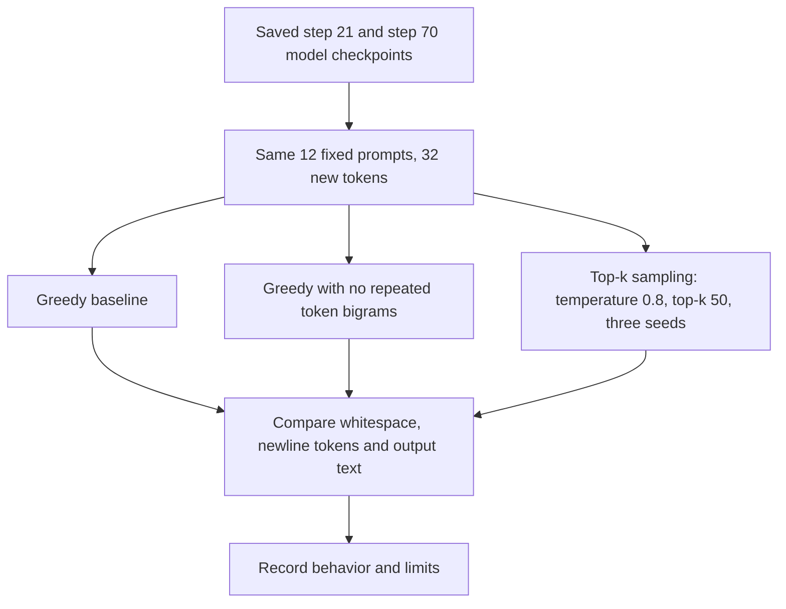

# Step 9 — Decoding behavior test

Date: 20 November 2026. This is a read-only model test, not a model or application change.

## Process

Run from repository root: `.venv-training/bin/python artifacts/step9_decoding_probe.py`. The script records all prompt/output token IDs and text in [results](STEP_9_DECODING_PROBE.json), checks checkpoint hashes before/after, uses CPU and suppresses PAD/UNK/BOS in every strategy. Each sampling run seeds with 42, 43 or 44 plus prompt index; this makes it reproducible but seeds overlap between some prompt/seed combinations, so the three samples are not independent estimates of quality.

## Observations

| Checkpoint | Strategy | Whitespace-only outputs / 12 | Newline tokens / total |
| --- | --- | ---: | ---: |
| 21 | Greedy | 12 | 384 / 384 |
| 21 | No repeated bigrams | 0 | 154 / 384 |
| 21 | Sampling, seeds 42 / 43 / 44 | 0 / 0 / 0 | 93 / 90 / 82, each / 384 |
| 70 | Greedy | 11 | 379 / 384 |
| 70 | No repeated bigrams | 0 | 101 / 384 |
| 70 | Sampling, seeds 42 / 43 / 44 | 0 / 0 / 0 | 129 / 114 / 112, each / 384 |

The repetition constraint prevents an identical adjacent-token pair from recurring; it does not prevent every repeated newline or ensure coherent text. Sampling selects other tokens, but the inspected examples are mostly fragmented words, punctuation, and newlines. At step 70 the first sample for prompt `একজন pilot` includes isolated domain terms interspersed with repeated newlines; it is not a usable answer. Merely being non-whitespace is not a readability or accuracy score.

This confirms that the greedy newline loop is sensitive to decoding strategy; it does not explain why the underlying distribution favors newline or prove that the model has learned useful text. Do not enable these experimental settings as a fix on this evidence. Full outputs remain available for human inspection; no factual or domain review was asserted.

The probe ran twice with identical JSON SHA-256 `290b092ecd550e60a61beed3b401e9114948d88ba2ab9b6a2350b29144e59a14`; checkpoint hashes remained unchanged on each pass. No training was performed.
